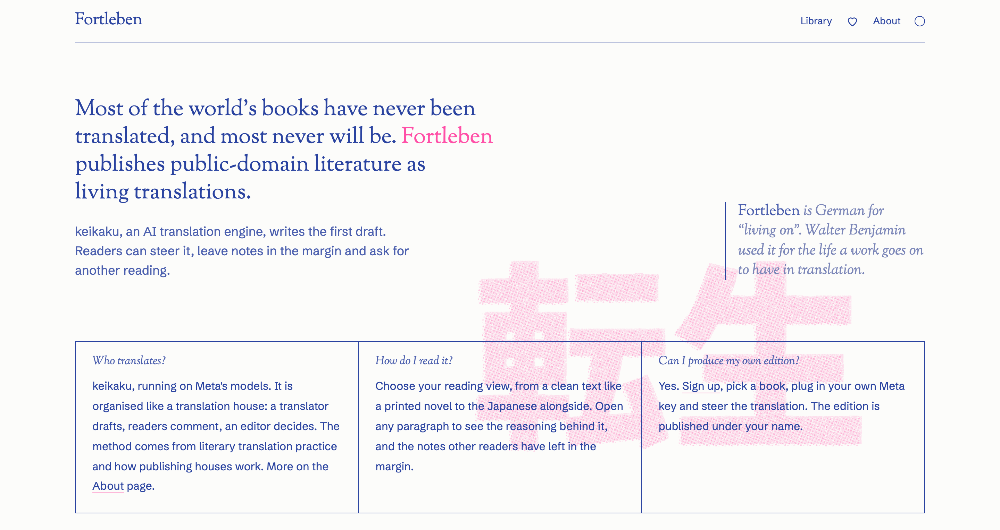

# Fortleben

Most of the world's books have never been translated into English, and most never will be: nobody will pay a translator for them. Machine translation hasn't been an answer for literature. The systems are optimised for sentences, not books, and a model asked to translate a story in one go keeps the source's clause order, flattens the register and misreads who is doing what. The craft that makes a translated novel readable lives with literary translators and their editors, and it has mostly been left out of the software.

Fortleben is an open-source answer for those books. **keikaku**, a multi-agent translation system on Meta's models, works the way a publishing house does: a reading of the whole text first, a codex of the cast and their voices, a drafter, two readers, a desk that settles their notes and a final read, with a human editor steering at the point where it is cheapest to be wrong. Every edition is published free with its working on show, and goes on changing after publication: editors correct it paragraph by paragraph, and readers leave notes in the margin. The first language is Japanese.

This repo holds both the keikaku engine, which you can run yourself from the command line, and the platform behind [fortleben.press](https://fortleben.press), where people read the editions, comment on them, add works to the wishlist and run translations on their own Meta key.

<p align="center"><a href="https://fortleben.press"></a></p>

**Start here.** Read [「酒虫」 The Wine Worm](https://fortleben.press/read/shuchu) by Akutagawa and [its analysis page](https://fortleben.press/read/shuchu/analysis), which shows the reading the system worked from. [Watch the video](https://www.youtube.com/shorts/0lsGS9C_920). Or run the whole site from the recorded runs, with no key and no spend:

```sh
uv sync
uv run keikaku serve --replay          # http://127.0.0.1:8000
```

Built in 10 days during the Meta Global AI Developer Hackathon 2026.

## What it does

- **Translates a whole work in stages.** A reader forms a reading of what the text turns on. A codex records the cast, how each of them speaks and the recurring images. A drafter writes plain English a page at a time. Two readers check each page, one against the Japanese and one as English. A desk settles their notes against the reading. A final read and a copy edit finish it. The stages are in [docs/STAGES.md](docs/STAGES.md).
- **Stops once for the editor.** Before anything is drafted, the editor sees the reading, the codex and page 1 in each voice the text allows. They can send notes in plain words, edit the reading, the codex and the voices by hand, or approve as they stand. After approval nothing waits for them. See [docs/EDITORS-DESK.md](docs/EDITORS-DESK.md).
- **Publishes the working with the text.** Each edition shows the English beside the Japanese with its ruby, the translator's notes in the margin, and every edit after release with who made it. The analysis page shows the reading the system worked from and what the editor changed in it.
- **Adds any out-of-copyright work from Aozora Bunko.** Paste a link. Code checks the rights rule from the work's card (everyone credited died by 1931, first published by 1930) and refuses anything else with the reason.
- **Lets anyone take part.** Readers comment on any paragraph. Every comment is screened by Spark before it shows, rate-limited and hidden on reports, and the editor gets a daily email with links to hide or restore. A public wishlist anyone can add to. Sign-up to run a translation on your own Meta key.

## Does it work

Every version is audited blind: the auditor gets the Japanese and the versions unlabelled and in shuffled order, marks fidelity slips (critical, serious, minor) and sentences a literary editor would mark as reading like a translation, and ranks them. A one-shot translation by Spark, given only "Translate the following Japanese text into English", sits in every comparison as the baseline, and where one exists, a published human translation beside it. Rankings are trusted over counts. The write-ups are in [docs/experiments/](docs/experiments/README.md).

- **「酒虫」, Akutagawa:** keikaku ranked first, above Glenn W. Shaw's 1930 published translation and the one-shot. It had 2 serious stiff sentences against the one-shot's 11; the gap widens on harder prose. The run cost $1.11.
- **『草枕』 chapter II, Sōseki:** first again, ahead of the one-shot and Kazutomo Takahashi's 1927 *Unhuman Tour*. The one-shot keeps Japanese clause order in exactly the loftiest passages, and puts the old woman at her own wedding. $1.07.
- **「晩餐」, Shiraki Shizu:** the first version to rank above the one-shot did so in two separate audits, after the draft was changed to be written as English first with fidelity restored by the readers afterwards. That finding reversed the pipeline's design.
- **What still goes wrong:** a few long sentences per text built in Japanese order, which every version gets wrong, and on four new texts five to ten misreadings each that no stage had been aimed at. The readers and the final read now check sense first.

## Which Meta model does what

Two models, both through the Meta Model API (the Responses API, with the OpenAI SDK pointed at Meta's endpoint). No other provider's model runs anywhere in this repo.

- **`muse-spark-1.3`** does the volume: divides the text into parts, writes the codex, drafts, reads as both readers, copy-edits, writes the translator's notes, screens comments and writes the title and blurb for a newly added work.
- **`muse-wonder-1.0`** does the judging: forms the reading of the text and checks it, reads the editor's notes at the checkpoint, decides at the desk, does the final read and runs the audits.

The split was measured, not assumed. Spark drafting, reading and editing cost about 30% less than Wonder with no quality difference we could find, so Spark does the volume. On the final read Wonder found meaning errors that Spark couldn't see, so the final read moved to Wonder, where the first reading, the desk and the audits already were. `keikaku run` takes `--draft-model`, `--reader-model`, `--desk-model` and `--final-model` (`spark` or `wonder`) for anyone who wants to rerun the comparison.

Beyond the calls themselves:

- **Tool loops.** The desk, the final read and the copy desk work through function tools (`edit`, and `find` for the copy desk): the model makes exact edits to the English and the code applies them, for up to 12 turns (30 for the copy desk). Each turn is an ordinary call, cached and ledgered.
- **Prompt caching, deliberately.** Every call after the codex carries a `prompt_cache_key` per work and codex version, so a new codex starts a new cached prefix. We measured that strict structured output gets no prompt-cache hits across separate calls, so Spark calls go non-strict and the client validates every answer itself; Wonder calls go strict because non-strict Wonder left fields empty. On the recorded 「晩餐」 run the desk's second turn had 19,444 of 20,943 input tokens cached.
- **A Meta model judges Meta models.** `keikaku audit` runs the blind audit on Wonder, with a Spark one-shot as the baseline, so anyone with a key can rerun the comparison on any run in the database.
- **Cost.** A short story costs about a dollar; a 149,000-character novel is priced at about $23. Every run is estimated before it starts from token counts fitted on eight runs, and those runs came in within 10% of the figure before its safety margin.

## How it's built

One Python process: a FastAPI site, the engine and a SQLite database with an append-only event log. Everything a run does is written to the database as it happens, and the site reads that record. [docs/ARCHITECTURE.md](docs/ARCHITECTURE.md) is the map.

- **Limits are code, not prompts.** Spend caps are checked before every call, and a whole run is estimated and refused before it starts if it won't fit. Forks, retries and note counts are capped by code and schemas. The tests include a client that lies about its usage, and the caps hold.
- **Every answer is validated.** Output is JSON against the prompt's schema with every key required, plus one plain `say` sentence for the log. An incomplete or junk answer is logged as a failed call, retried once and never cached.
- **Exact replay.** Every good answer is cached under the model, effort, the hashes of instructions, input and schema, the tools and the turns so far. The same call again costs nothing, a stopped run resumes paying only for new calls, and `--replay` reruns a recorded work from the cache alone. A call with no recording fails loudly, so no test can spend.
- **Memory is a codex, not a longer prompt.** Above 15,000 characters a drafting call sees its own part in full and every other part in one line, so a page costs the same however long the book is. The reading and the codex are versioned, and every stage reads the editor's version if there is one.
- **Independent calls run side by side,** up to `KEIKAKU_PARALLEL` at once, with results stored in their original order so the record reads as a serial run.
- **Prompts are files.** No Python file contains prompt text. [docs/PROMPTS.md](docs/PROMPTS.md) lists each one with its caller and model, and [docs/FROM-TRANSLATORS.md](docs/FROM-TRANSLATORS.md) maps each stage to the practice it was taken from.
- **Built to be public.** No secrets in the repo; passwords are scrypt hashes and tokens are stored hashed; reader text reaches a model only as quoted data, never as instructions. [docs/CONVENTIONS.md](docs/CONVENTIONS.md) has the rest.

## Running it

You need Python 3.12 and [`uv`](https://docs.astral.sh/uv/). Nothing below needs a key.

```sh
uv sync
uv run keikaku serve --replay           # the site at http://127.0.0.1:8000, serving the recorded runs
uv run keikaku --replay run bansan      # replay the recorded run of 「晩餐」 in the terminal: no key, no network, no spend
uv run pytest                           # the tests, also keyless
```

`--replay` serves every model call from the recordings in `fixtures/<work>/`. Six works are recorded there, each the complete record of a live run: every call's model, tokens, cost and response, the readers' notes, the desk's decisions and the event log.

| id | work | author |
|---|---|---|
| `bansan` | 「晩餐」 Supper | Shiraki Shizu |
| `shuchu` | 「酒虫」 The Wine Worm | Akutagawa Ryūnosuke |
| `yukigeshiki` | 「雪景色」 Snowscape | Makino Shin'ichi |
| `shokikan` | 「書記官」 The Secretary | Kawakami Bizan |
| `shiken` | 「死剣と生縄」 Dead Sword, Living Rope | Emi Suiin |
| `nekohachi` | 「猫八」 Nekohachi | Iwano Hōmei |

To run live, copy `.env.example` to `.env` and set `MODEL_API_KEY` (a Meta Model API key). Then:

```sh
uv run keikaku fetch                              # fetch the works in fixtures/works.json
uv run keikaku --cap 3 run sumiyaki               # one work through every stage, with a $3 run cap; nothing stops
```

With `--checkpoint` a run stops once, after the reading and the codex are written and page 1 is drafted in each voice, and before anything else is drafted:

```sh
uv run keikaku run sumiyaki --checkpoint          # runs to the checkpoint and stops
uv run keikaku checkpoint sumiyaki                # writes the reading, the codex and the voices as Markdown to checkpoints/sumiyaki/
uv run keikaku steer sumiyaki "make it plainer"   # optional: a note in plain words; keikaku replies, updates the files and redrafts page 1
uv run keikaku approve sumiyaki --voice 0         # pick a voice, numbered from 0 as in the voices file
uv run keikaku run sumiyaki --from draft          # the rest of the run; nothing waits for you again
```

While it waits you can do any of these, in any order, as often as you like:

- **Send a note.** Each note is one round: keikaku reads it against the files, replies, says what it changed, asks a question if it has one, and redrafts page 1. A round on a short story costs about a quarter of a dollar.
- **Edit the files.** The reading and the codex are, under their titles, exactly what every later stage reads; change them and the next `checkpoint`, `steer` or `approve` takes your version. In the voices file you can edit each voice's name and its one-line description, but not the drafted pages. An edit that can't be taken (the run has been approved, or the files belong to another run) is kept aside and never written over.
- **Approve.** With no note and no edit, keikaku's choices stand; approve in the voice you want and carry on from the draft.

The result is the released edition in `releases/<work>-<version>.json` in the data folder (`KEIKAKU_DATA_DIR`, else `var/`): the English, the translator's notes, the Aozora colophon and the record of the run. `keikaku serve` on the same database publishes it on the site, and `keikaku download sumiyaki` writes a zip of the run with one Markdown file per edition.

```sh
uv run keikaku fixture bansan                     # export a run to fixtures/<work>/ so it replays without a key
uv run keikaku audit bansan --runs 1 2 --baseline --readable  # blind audits of runs 1 and 2 beside a one-shot
```

[AGENTS.md](AGENTS.md) walks a coding assistant through steering a run on someone's behalf.

`keikaku add <url>` adds a work from an Aozora Bunko link if it passes the rights rule; `keikaku wish <url>` puts one on the wishlist. `keikaku serve` without `--replay` serves the live database, with the recorded runs loaded into it once. `keikaku invite "Name"` makes an invite link to the editors' desk with an allowance on it.

Every run is priced before it starts and refused if the estimate won't fit its cap or what's left of the daily and total caps (`--cap`, or `KEIKAKU_CAP_RUN`, `KEIKAKU_CAP_DAILY` and `KEIKAKU_CAP_TOTAL`). 「晩餐」 estimates at about $1.25. `HOUSE_OPEN=false` stops all live calls. Runs on an editor's own key are held to the run cap only.

The site runs as one service from the `Dockerfile`, with the database on a volume at `KEIKAKU_DATA_DIR`; `bin/serve.sh` starts it under Litestream when a backup bucket is set. Every setting is listed in `.env.example`.

## Docs

- [Architecture](docs/ARCHITECTURE.md): the parts of the system, the data model, models, cost and hosting.
- [Stages](docs/STAGES.md): the exact order the orchestrator runs, and the limits code enforces.
- [Story state](docs/STORY-STATE.md): how the system remembers a text: the reading, the codex and what each call sees.
- [Prompts](docs/PROMPTS.md): every prompt, who calls it on which model, and how they're written.
- [The editors' desk](docs/EDITORS-DESK.md): steering a run: invites and own keys, the checkpoint, approval, editing an edition.
- [The site](docs/SITE.md): every page, comments and moderation, accounts.
- [Conventions](docs/CONVENTIONS.md): repo layout, tests, fixtures, configuration.
- [From translators](docs/FROM-TRANSLATORS.md): what we took from how literary translators and editors work.
- [Experiments](docs/experiments/README.md): what we tried while building the system, the numbers, and what changed because of them.
- [References](docs/REFERENCES.md): the papers and books the design draws on.

## Licence

The code, prompts and docs are AGPL-3.0-or-later: if you run a changed version as a service, you share your changes. The English keikaku produces, and the recorded runs in `fixtures/`, are CC BY-SA 4.0. See `LICENSE`.
