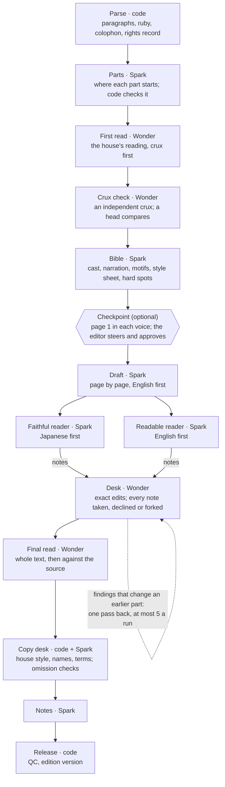

# Architecture

Fortleben is one Python process: a FastAPI site, a translation engine (keikaku) and a SQLite database. The engine takes a Japanese work from Aozora Bunko and runs it through a fixed sequence of stages, each one or a few calls to one of two Meta models, `muse-spark-1.3` (Spark) and `muse-wonder-1.0` (Wonder). Everything a run does is written to the database as it happens, and the site reads that record.

This page is the map. The exact stage order and the limits code enforces are in [STAGES.md](STAGES.md); how the house remembers a text across calls, in [STORY-STATE.md](STORY-STATE.md); every prompt, in [PROMPTS.md](PROMPTS.md); the site page by page, in [SITE.md](SITE.md); steering a run, in [EDITORS-DESK.md](EDITORS-DESK.md).

## The parts

| Part | Where | What it does |
|---|---|---|
| Command line | `house/cli.py` (`keikaku`) | Fetch and add works, run them, steer at the checkpoint, export fixtures, audit, serve, invite, moderate |
| Orchestrator and stages | `house/orchestrator.py`, `house/stages/` | The stages in order, one module each with `run(ctx)`; the up-front estimate; stop and resume |
| Context | `house/context.py`, `house/pager.py` | What each call sees, stable blocks first; pages and parts |
| Model client | `house/client.py` | The only code that calls a model: validation, retries, the response cache, the ledger |
| Budget | `house/budget.py` | Prices, the run estimate, the caps, the kill switch |
| Source adapter | `house/lang/ja/` | Reads an Aozora card; parses its ruby text into paragraphs |
| Intake | `house/acquire.py`, `house/works.py`, `house/wishlist.py` | Adds a work from an Aozora link if it passes the rights rule; the wishlist |
| Database | `db/schema.sql`, `house/db.py`, `house/events.py` | One SQLite file and its append-only event log |
| Site | `house/web.py`, `house/edition.py`, `site/` | Reading pages, the margin, the analysis, the wishlist |
| Editors' desk | `house/desk.py`, `house/steer.py`, `house/accounts.py` | Invites, sign-in, own keys, allowances in drops, runs from the browser, the checkpoint |
| Comments | `house/comments.py` | Margin comments, screening, reports, the daily email |
| Fixtures and audits | `house/fixture.py`, `fixtures/`, `house/audit.py` | Recorded runs that replay with no key; blind audits beside a one-shot translation |

Prompts are files in `prompts/` and output schemas are files in `house/schemas/`. No Python file contains prompt text.

## A run

There is no manager agent. The orchestrator is plain code that calls the stages in a fixed order. Each stage writes its results to the database before the next starts, so a run can stop after any stage and pick up from the record.

The first read, the crux check and the bible see the whole text; the draft goes page by page; the readers, the desk and the notes go a part at a time. A few things hold throughout:

- **One edit tool.** After the draft, only the desk, the final read and the copy desk change the English, all through the same tool (`Editor` in `house/stages/common.py`). An edit names the exact words to replace. If they aren't found exactly once (or `replace_all` is set), nothing changes and the model is told where the words are, so it can try again. An edit never crosses a paragraph, and code checks every changed paragraph for stray scripts and for shrinking below 70% of its length.
- **One decision per note.** The two readers never see each other or the translator's notes. The desk must take each note with an edit, decline it with a reason, or record a disagreement; anything left is marked unaddressed and flagged. A part with no notes never reaches the desk. There are no rounds of debate.
- **Limits are code, not prompts.** At most five forks a run from the desk, plus the crux fork; at most five findings taken back to earlier parts, once; note counts capped by the schemas; spend caps checked before every call.
- **Every answer has a `say` field**, one plain sentence for the log. An answer whose sentence is junk counts as broken: it is retried and never cached. The models don't expose their reasoning, so what the agents write is the whole visible record.
- **Independent calls run side by side.** The readers' calls (both readers, every part) and the checkpoint's voice takes go out up to `KEIKAKU_PARALLEL` at once (default 4). Results are stored in their original order, so the record matches a serial run. Drafting stays in order, because each page sees the English before it.

**Stop and resume.** `keikaku run <work> --to bible` stops after a stage, `--from desk` resumes the latest run from one, `--only` reruns one. Each stage skips what it has already stored and the response cache serves calls already made, so a resumed run pays only for new calls. A stage that throws marks the run `failed`; a cap that runs out marks it `stopped: budget`. Either way nothing is released, and the error says how to resume.

## Which model does what

Every model this repo calls is a Meta model, through the Meta Model API.

| Call | Prompt | Model | Effort | Run option |
|---|---|---|---|---|
| Parts | `parts` | Spark | low | |
| First read | `first-read` | Wonder | medium | |
| Crux check | `crux-check`, then `head-select` | Wonder | low | |
| Bible | `analyst-bible` | Spark | medium | |
| Checkpoint voice takes | the drafting prompt | as the draft | medium | |
| A steering note at the checkpoint | `steer` | Wonder | medium | |
| Draft | `translate-draft-plain` (or `translate-draft`) | Spark | medium | `--draft-model`, `--draft-prompt` |
| Readers | `reader-faithful`, `reader-readable` | Spark | medium | `--reader-model` |
| Desk | `desk` | Wonder | medium | `--desk-model` |
| Final read | `final-read` | Wonder | medium | `--final-model` |
| Copy desk | `copy-desk` | Spark | low | `copy_model` (no flag) |
| Notes | `notes` | Spark | low | |
| A work's English title and blurb, on adding it | `work-card` | Spark | low | |
| Screening a comment | `reader-proposal` | Spark | low | |
| Audits; their one-shot baseline | `audit-spans`, `audit-readable`; `baseline-oneshot` | Wonder; Spark | medium | |

The defaults (`DEFAULTS` in `house/stages/common.py`) are the best set-up the experiments found ([experiments/](experiments/README.md)). Wonder takes the jobs that weigh most and need the whole text in one call: the reading, the crux, the desk, the final read. On three texts audited blind, a Wonder final read made twice the meaning fixes a Spark one did (experiment 10). Spark does the volume. The two come from the same family, so a Wonder desk over a Spark draft is a different and stronger checkpoint, not an independent one.

**Strict schemas.** We measured that strict structured output gets no prompt-cache hits across separate calls. So Spark calls go non-strict and the client validates every answer itself. Wonder calls go strict, because non-strict Wonder left required fields empty and wrote filler on long outputs, and its calls are few. The readers are strict on either model; they run once a part. Inside one tool loop, later turns hit the cache even when strict: on the recorded 「晩餐」 run, the desk's second turn had 19,444 of 20,943 input tokens cached.

**Downgrade.** A Wonder answer that fails validation twice is asked for once more on Spark, and a `call.downgraded` event records it.

## The model client

- **Requests.** The OpenAI SDK, pointed at `https://api.meta.ai/v1` (or `MODEL_API_BASE`), on the Responses API. Instructions are always the house brief (`prompts/house-brief.md`) followed by one department prompt. Calls after the bible carry `prompt_cache_key` `<work>:bible-v<N>:<stage>`, so a new bible version starts a new cached prefix, with 24-hour retention. `store` is off. The SDK retries 429s and 5xx four times with backoff.
- **Validation.** Output is JSON against the prompt's schema, checked with every key required. An incomplete, invalid or junk answer is logged as a failed call and retried once.
- **Tool loops.** The desk, the final read and the copy desk get function tools (`edit`; the copy desk also `find`). `Ctx.loop` runs each tool call and sends the result back until the model answers, for up to 12 turns (30 for the copy desk). Meta's API takes `tool_choice: "auto"` only, so the model decides when it's done. Each turn is an ordinary call, cached and ledgered.
- **The response cache.** Every good answer is stored under a key made of the model, effort, the hashes of instructions, input and schema, the tools, the turns so far, and strictness. The same call again costs nothing. The cache is `cache/responses/` in the data folder; the client also reads every `fixtures/*/responses/`.
- **FakeClient** serves the same cache and never calls out. `make_client` returns it under `--replay` or with no key; a call with no recording raises `FixtureMissing`. `keikaku fixture <work>` exports a run's responses and full record to `fixtures/<work>/`, which is how 「晩餐」 and 「酒虫」 replay with no key. The tests run the same way.

## Spend: the ledger, the estimate, the caps

Every call, live or cached, gets a row in `call`: model, effort, input, cached, output and reasoning tokens, what it cost now (0 from the cache) and what it cost when first made. Prices per million tokens, from `house/budget.py`:

| Model | Input | Cached input | Output, reasoning included |
|---|---|---|---|
| `muse-spark-1.3` | $1.25 | $0.15 | $4.25 |
| `muse-wonder-1.0` | $4.00 | $0.20 | $20.00 |

**Before each live call**, a cautious estimate (1.5 tokens a character, nothing cached) is checked against the run's cap and what's left of today's and the total. A call that would pass any of them raises `CapExceeded`. `HOUSE_OPEN=false` refuses every live call.

**Before a run starts**, the whole run is estimated and refused if it won't fit: better no translation than one that stops half-way. `estimate_run` prices each stage per call from token counts fitted on eight runs of 3,400–19,500 characters. A call's input is a fixed part (prompt, reading, bible) plus a part that grows with the source it sees; its output stays about the same whatever the length. The estimate assumes every call is live and every earlier part goes back to the desk once, then adds 15%.

| Stage | Calls | Model | Input tokens | Output a call | 「晩餐」, 3,400 chars | 149,000 chars, 8 parts |
|---|---|---|---|---|---|---|
| Parts | 1 | Spark | 2,300 + 0.26 a character | 1,500 | $0.01 | $0.06 |
| First read | 1 | Wonder | 2,100 + 1.1 | 3,900 | $0.10 | $0.74 |
| Crux check | 2 | Wonder | 4,400 + 0.84 | 2,700 | $0.09 | $0.57 |
| Bible | 1 | Spark | 5,000 + 0.86 | grows, to 32,000 | $0.04 | $0.30 |
| Draft | a page | Spark | 8,600 + 1.02 of what it sees, mostly cached | 3,500 | $0.13 | $6.62 |
| Readers | 2 a part | Spark | 500 + 6.7 of the part | 25,000 together | $0.14 | $2.10 |
| Desk | a part, plus one per earlier part | Wonder | 8,600 + 2.86 | 6,500 | $0.20 | $5.66 |
| Final read | a part | Wonder | 7,200 + 2.36 | 9,000 | $0.24 | $3.08 |
| Copy desk | 2 turns + 1 per 600 chars, at most 30 | Spark | 14,000 + 0.65, mostly cached | 1,400 | $0.10 | $0.62 |
| Notes | a part | Spark | 8,400 + 2.72 | 2,200 | $0.04 | $0.67 |
| **Before the 15%** | | | | | **$1.07** | **$20.41** |
| **The estimate** | | | | | **$1.23** | **$23.47** |

The eight runs came to 0.89–1.10 of the figure before the 15%. The recorded 「晩餐」 run in `fixtures/` (3,410 characters, 26 calls, the default set-up) cost $0.97, 0.91 of it. The recorded 「酒虫」 run (6,731 characters, 23 calls, an earlier set-up with a Spark final read and no copy desk) cost $0.94. A book has been priced, not run. Running the desk on Spark takes 「晩餐」's estimate from $1.23 to $1.05; experiment 2 found no clear difference in quality.

**Caps.** The run cap is `--cap` or `KEIKAKU_CAP_RUN`, default $30, enough for a novel; the daily cap `KEIKAKU_CAP_DAILY`, default $30; the total `KEIKAKU_CAP_TOTAL`, default $100. A resumed run keeps the cap it started with. If a cap is reached mid-run, the run stops, releases nothing, and says which cap to raise and where to resume; the cache means nothing done is paid for twice.

## Drops of ink and allowances

People on the site never see dollars. Effort is counted in **drops of ink** (`house/desk.py`): one drop is `KEIKAKU_DROP_USD`, default $0.0006. Length is counted in **sheets** of 400 source characters, the 原稿用紙 the period's writers were paid by.

- **The estimate an editor sees** is sheets × a rate: the average cost per sheet of the last five finished runs in the ledger (at first-made prices, so replays count), plus a tenth, never below 100 drops a sheet. Before any run has finished it is `DESK_DROPS_PER_SHEET`, default 175, measured on 「晩餐」 (1,486 drops for 8.5 sheets, about $0.89).
- **An invited editor has an allowance**, 4,000 drops unless `keikaku invite --drops` says otherwise. Starting a run reserves the whole estimate, and the run's cap is the reservation plus 20%. When an attempt ends, the run is charged what it spent, never more than the reservation (an overrun is the house's), and the rest is released. Resuming a run that used its whole reservation holds a quarter more and raises its cap to match.
- **An editor on their own key** has no allowance. Their runs spend their key, are held to the run cap only, and don't count against the house's daily or total caps. Their desk shows spend in tokens.
- **Capacity:** one run going per person, at most three queued or running across the site.

## The checkpoint

A run started with `--checkpoint`, or from the desk with the review on, stops after the bible. The checkpoint stage drafts page 1 once in each voice the reading offers, with the run's own drafting prompt and model, keeps the drafts in a `checkpoint` document (not as revisions), and sets the run `waiting`. The editor can then:

- **send a note** (`keikaku steer`, or the desk). One Wonder call with the `steer` prompt carries the note into the reading and the bible and replies; page 1 is drafted again in the chosen voice. New versions are saved only where something changed.
- **edit by hand** the reading, the voices, the bible, or page 1 in a voice. Every later call reads the editor's version. `keikaku checkpoint <work>` writes these as Markdown under `checkpoints/<work>/` in the data folder and reads back what was changed.
- **approve a voice** (`keikaku approve --voice N`). The run carries on from the draft, whose page 1 comes from the response cache, since its prefix matches the checkpoint's.

Each round, edit and approval is an event, so the review is part of the record.

## Long texts

What a call sees depends on length, and only `house/context.py` decides it ([STORY-STATE.md](STORY-STATE.md) has the reasons).

- **Pages** are whole paragraphs, about 650 source characters, closing early at a scene break. A drafting call also sees the two paragraphs before it with their English and the next paragraph of Japanese, read-only. From page 2 the house's first page is the voice reference.
- **Up to 15,000 characters**, every drafting call has the whole source in its cached prefix. Above that, it has its own part in full and every other part in one line, so a page costs the same however long the book is.
- **Parts.** One cheap Spark call over the book's outline says where parts start. Code checks the answer covers the book once, in order, with no part over 25,000 characters, else falls back to headings or merged scene breaks. The final read works a part at a time above 15,000 characters.
- **The first read, crux check and bible** always see the whole source.

## The database and the event log

One SQLite file in WAL mode, `keikaku.db`. `house/db.py` applies `db/schema.sql` on every connect and adds columns to older databases. JSON columns hold text shaped by the schemas in `house/schemas/`.

| Tables | Hold |
|---|---|
| `work`, `segment` | A work (Aozora card, colophon verbatim, rights record, English title and blurb); its paragraphs `p1`, `p2`… with ruby tokens and sentence anchors `p12-s3` |
| `run` | One pass of a work: status, last stage done, cap, options (models, prompt, voice, editor, reservation) |
| `bible` | Versioned documents per work: reading, crux check, story bible, parts plan, checkpoint; each points at the event that made it |
| `revision` | The English per paragraph, or per group the drafter joined, versioned, each pointing at its cause |
| `query`, `fork`, `note`, `status` | Readers' notes, code flags and final-read notes with how each was settled; choices sent to the editor with both sides verbatim; reader-facing notes; *draft* or *house-checked* per paragraph |
| `event`, `call` | The log; the spend ledger |
| `edition`, `release` | An edition per work and editor; its versions (v0.1, v0.2…) |
| `person`, `allowance`, `invite`, `session`, `reset` | People, drops, invite links, sign-ins, reset links; tokens stored as hashes only |
| `comment`, `comment_report`, `comment_digest`, `wish`, `wish_ask` | Comments and reports; the wishlist and who asked, by hashed address |

The schema also has tables no code writes (`author_file`, `rule`, `lock`, `intern`, `reaction`, `proposal`, `report`, `vote`, `request`), and `term`, kept only so `keikaku audit` can read runs recorded before the term ledger was dropped.

**The event log** is append-only: run, sequence number, actor (a department and role, a person, or `house`), type, payload, the cost of the call behind it. The types are listed with a line each in `house/events.py`, and emitting an unknown one is an error. They cover each stage, every call and its `say` line, each version of the reading and bible, the checkpoint, every change to the English, every note and how it was settled, forks and the release. Outside runs, `work.added` and `work.refused` record each Aozora link read.

**The margin is a database read.** Every revision, note, decision and fork is stored against a paragraph, and a paragraph's margin is everything anchored to it. There's no separate collection step, so no decision can happen without showing up somewhere.

**The data folder** is `KEIKAKU_DATA_DIR`, or the repo's `var/`. It holds `keikaku.db`, `cache/responses/`, `sources/` (texts added from links), `releases/`, `audit/` and `checkpoints/`.

## Works and the rights rule

A work is either in the repo's `fixtures/works.json` (texts in `fixtures/sources/`, fetched with `keikaku fetch`) or added from an Aozora link, with an id starting `aozora-`. Links come in through `keikaku add`, the desk, or the wishlist (`/wishlist`, `keikaku wish`), all through `acquire.add`.

The rule is code (`works.eligible`): the author died in 1931 or earlier and the work was first published by 1930. Adding from a link applies it strictly, from the card alone. The death that counts is the latest of everyone credited, a translator's included. A year that can't be read is a refusal, never a guess. A 初出 note naming any year after 1930 is refused, since Aozora's text may be the later version. A work split across cards, or with no ruby text, is refused.

Fetching stays on Aozora: https only, at most two redirects, a 20-second timeout, 5 MB at most. One small Spark call writes the English title, romanised author and blurb; if it fails, the work is added without them and the call is retried at most once an hour. A refusal on what the card says is remembered for 30 days. Limits: ten cards read a day per editor; on the wishlist, five links an hour per address and ten new cards a day in all.

Every release carries the work's Aozora colophon, and the notes prompt never voices a note as the author's.

## The site

`house/web.py` is a FastAPI app serving Jinja templates and plain CSS and JavaScript from `site/`, with no build step.

- **Reading.** `/` is the shelf. `/read/<work>` shows an edition: one English text, the Japanese with ruby, and each paragraph's margin. Presets (Clean, Curious, Annotated) change the layout and which notes show, never the English. `/read/<work>/analysis` shows the reading and the bible the edition was drafted under.
- **Editions.** An edition belongs to its editor: the house, or the person who ran it from the desk. An editor's next run of a work revises their own edition. After release, the editor can change any paragraph's English by hand; each change is a revision with an event keeping before, after and who.
- **Replay and live.** `keikaku serve --replay` builds a temporary database from `fixtures/`, starts no runs and takes no comments, so it works from a clean clone with no key. Without `--replay`, it serves the live database, loads the recorded runs into it once, and marks desk runs left going by a stopped process as interrupted.

Every form that changes something carries a CSRF token; responses forbid framing and sniffing; pages with a person's own details are never cached. More in [SITE.md](SITE.md) and [CONVENTIONS.md](CONVENTIONS.md).

## The editors' desk and accounts

Visitors can't start runs; editors can, from the desk, on works that pass the rights rule. Two ways in:

- **An invite link** (`keikaku invite "Name"`) makes a person with an allowance. Only a salted hash of its token is stored. Revoking it (`--revoke`) also ends the person's sessions and removes any email, password or unused reset link they had.
- **Signing up** (`/signup`: name, email, password) gives a desk with no allowance, where the editor adds their own Meta Model API key. The key is encrypted with `KEIKAKU_SECRET`, shown only as its last four characters, and decrypted only to build the client for that person's runs. Passwords are salted scrypt hashes; sessions last 90 days; a reset link is good for an hour, once.

A desk run uses the same orchestrator as the command line, in a background thread in the web process, so the request that starts it returns at once and the page polls for progress. A run whose own key is turned down can't resume, because a run can't change keys part-way. Before starting, the editor agrees that what they run is published, under the name they give.

## Comments and moderation

Anyone can comment on a paragraph with no account. Code checks come first: 1,200 characters, one link, limits per writer and per address by the hour and day (both stored hashed), 200 a day across the site. Then Spark screens the comment and its name in the background. Until it passes only its writer sees it; if it fails, its writer sees why. A background loop every 15 minutes rescreens any comment whose screen didn't run. Reports from two different addresses hide a published comment. Once a day (after 8:00 UK time) the editor gets an email listing the day's comments, what the screen stopped and what readers reported, each with a signed link to hide or restore it; `keikaku comments` does the same from the terminal. Nothing is deleted. Mail goes through Resend (`RESEND_API_KEY`), or to the server log without a key.

## Hosting

One Railway service, built from the `Dockerfile` on push.

- **The image** is `uv` on Python 3.12 with Litestream 0.3.13. `bin/serve.sh` runs `keikaku serve --host 0.0.0.0 --port $PORT`, under `litestream replicate` when `LITESTREAM_BUCKET` is set.
- **The volume.** Everything a run makes is in `KEIKAKU_DATA_DIR`, set to the volume's mount path. The rest of the filesystem is wiped on each deploy, and the volume isn't mounted during the build.
- **One instance.** Run threads, the run locks and the sign-in and edit rate limits live in process memory, so the site runs as a single process. A service with a volume can't have replicas anyway; a redeploy means a few seconds' downtime.
- **Behind the proxy.** Railway appends the visitor's address to `X-Forwarded-For`. With `KEIKAKU_TRUST_PROXY=true` the rate limits use its right-most value, the one the proxy added. It's off by default: reached directly, a client can put anything in that header.
- **Backup.** Litestream (`litestream.yml`) streams the database continuously to S3-compatible storage. To restore onto an empty volume, service stopped: `litestream restore -config litestream.yml "$KEIKAKU_DATA_DIR/keikaku.db"`. The response cache isn't backed up; it only saves money. `keikaku download <work>` zips a run's record and editions for its editor.

| Variable (`.env.example`) | What it does |
|---|---|
| `MODEL_API_KEY`, `MODEL_API_BASE` | The site's Meta Model API key and an optional base URL. Without a key everything runs on FakeClient and the desk can't start runs |
| `KEIKAKU_DATA_DIR` | The data folder; on Railway, the volume |
| `KEIKAKU_CAP_RUN`, `_DAILY`, `_TOTAL` | Spend caps in dollars |
| `KEIKAKU_PARALLEL`, `HOUSE_OPEN` | Calls a stage may have out at once; the kill switch |
| `KEIKAKU_SECRET` | Salts token, cookie and address hashes; encrypts editors' keys; signs moderation links. Changing it voids every invite and stored key |
| `KEIKAKU_BASE_URL`, `KEIKAKU_CONTACT` | The site's address for links in mail and invites; a contact shown when reset mail isn't set up |
| `KEIKAKU_TRUST_PROXY` | `true` behind Railway's proxy |
| `RESEND_API_KEY`, `REPORT_EMAIL_TO`, `REPORT_EMAIL_FROM` | Mail: the daily email and reset links |
| `COMMENTS_*`, `REPORTS_*`, `DIGEST_HOUR` | Comment and report limits; the email's hour |
| `LITESTREAM_*` | Backup bucket, endpoint, region, keys |

Read by the code but not listed there: `KEIKAKU_DROP_USD`, `DESK_DROPS_PER_SHEET`, `SIGNUPS_PER_HOUR`, `COMMENTS_PER_HOUR_IP`, `COMMENTS_PER_DAY_IP`.
