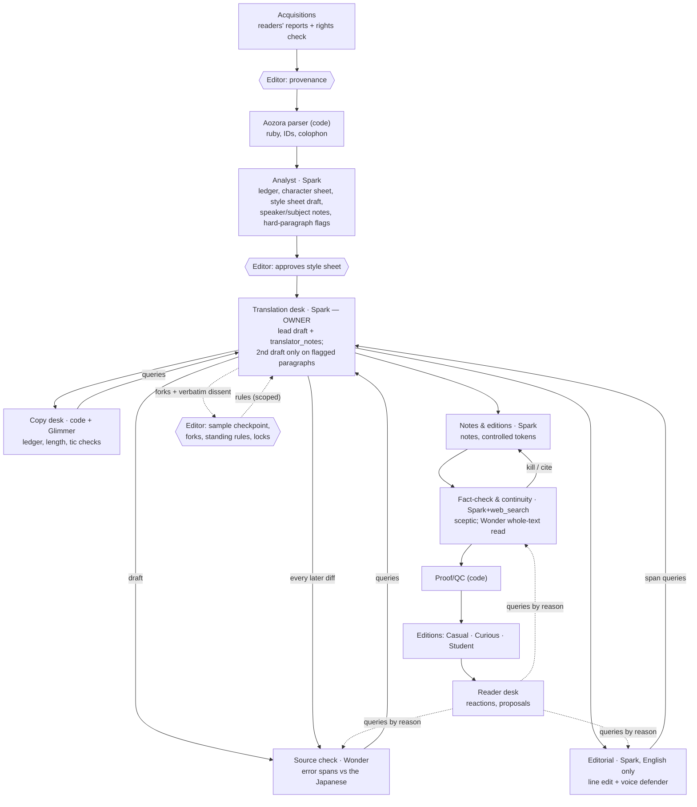

# keikaku — architecture

Written 27 Oct 2026, the second day of the hackathon; updated 28 Oct with the final text picks. The plan, not yet the code: sections change as the build proves or disproves them. See `CONCEPT.md` for what it's for and `BUILD-PLAN.md` for the order of work.

Design choices worth knowing first:
- **Source check runs on Wonder for every chunk**, not only on hard passages. It's affordable (§10), and same-model critique does most damage in exactly this department.
- **Editions share one base text**: one English string per sentence with controlled tokens, not three separate translations.
- **The catalogue's reader's reports are generated on Meta models.**
- **Glimmer works only on the English** unless a spot check shows it reads Japanese well. Its model card doesn't list Japanese.

## 1. Departments and flow

No manager agent. A deterministic orchestrator (plain code, a state machine per chunk) moves *text + open queries* between departments. Translation **owns** the English. Everyone else raises queries (`open → answered → accepted | stet | revised`). Department heads **select, never merge**, and send forks up with dissent quoted word for word.

Rounds are capped at two per query. If it's unresolved after that, it goes to the editor as a fork with a one-line trade-off per option (at most 5 forks per checkpoint, global ones first). Critics edit **flagged spans only** and may answer "none". The English-only pass never sees the Japanese, and every change it makes goes back through Source check. Sensitivity flags (dated or harmful content in the source) are a query type routed to the editor. They lead to context notes, never bowdlerising.

## 2. Data model (SQLite)

| Table | Holds |
|---|---|
| `work` | Aozora card, full colophon, rights record (death year, 初出, translation search + date), status |
| `segment` | `p12-s3` IDs from the source; Japanese with structured ruby; paragraph link. Alignment is by ID, with paragraph fallback when sentences merge |
| `revision` | Base English per segment, versioned. Each revision points at the event that caused it (draft, accepted query, rule, human edit) |
| `term` | Ledger: entity, reading, rendering per edition (Casual / Curious / Student), first-use note. Base text carries `{t:genin}` tokens, so **editions are presentations of one base text**, checked once |
| `note` | Anchor, editions it shows in, body, sources[], status `verified / unverified / killed`, author (department or person). Student hides anything unsourced |
| `query` | From → owner, span, category, reason, evidence[], recommendation, verbatim dissent, status, resolver |
| `fork` | Options (author + one-line trade-off), head's pick, the editor's decision, the rule it created |
| `rule` | Standing rule text, **explicit scope** (line / character / term / work / house), origin, lines it touched |
| `lock` | Segment, who locked it. Rules don't rewrite locked lines; they raise a query to the editor instead |
| `status` | Per segment: draft / house-checked / editor-approved / human-reviewed, plus who. Nothing waits on the last two |
| `event` | Append-only log: run, seq, actor (department + role, or person), type, payload, cost. The single source for history, the House stream and replay |
| `call` | Model, effort, tokens (input / cached / output / reasoning), $, prompt hash, cache key |
| `intern` | Department, brief, logged reason, budget, spend, report |
| `reaction`, `proposal`, `person` | Two-axis reactions; span proposals that become queries; trust level and how each person wants to be credited |
| `report` | Catalogue reader's report: reader-facing fields, internal scores, what it was based on, label, translation-status evidence and date |
| `release` | Edition version (v1, v1.1), changelog, credits |
| `vote` | "I'd read this": work, voter token (cookie + IP hash), date. One per voter per work |
| `request` | An Aozora work ID or an outside reference (title, author, link), the requester's reason (pre-moderated), the Acquisitions verdict (*eligible / in copyright / can't tell*) with evidence, the editor's decision, status |

## 3. Agent runtime

- Python `asyncio`, with the OpenAI SDK pointed at Meta's API on the **Responses API** (needed for caching hints, web_search and reasoning summaries). No agent framework.
- A department is a module: prompt files, a strict JSON schema, and `run(task, state) → queries | edits | notes`. Every output schema has a `say` field, one plain sentence for the House log. Muse never exposes its reasoning, so the visible debate *is* what the agents write.
- Translation runs chunk by chunk in order, because the state is carried forward. Other departments work behind it in parallel, under a concurrency semaphore. 429s and 5xx get retries with backoff.
- **A response cache** keyed on (model, prompt hash, input hash) makes reruns in development free and replays deterministic.
- **Standing-rule propagation:** a scoped search (ledger plus regex, then a cheap Spark classifier on the candidates) finds the affected segments. Translation revises them as queries. The UI shows "R4 · 12 lines, 2 locked lines sent to the editor".

## 4. Which model does what

| Job | Model | Why |
|---|---|---|
| Analyst, translation, editorial, notes, query answers | `muse-spark-1.3`, effort medium for drafting and low elsewhere; `prompt_cache_key` per work + style-sheet version | Strong and cheap. The stable prefix caches at 88% off |
| Source check (every chunk, every diff); critic at forks; whole-text continuity read | `muse-wonder-1.0`, effort low | A different and stronger checkpoint from the drafter. The 1M context holds the whole source and translation in one call |
| Copy desk (English-side tics, register, consistency) | Muse Glimmer 30B: locally via Ollama for batch runs; on Modal for the live site (Muse Spark Open on Baseten if that falls through) | Open weights, near-free. Rewrites flagged spans only |
| Fact-check | Spark + `web_search` | Every note cites a source or dies |
| Catalogue | Spark low as the acquisitions editor; Glimmer as chunk reader if it passes a 10-report spot check, else Spark | Cheap at 200 reports |
| Requests from outside Aozora | Spark low + `web_search`: author dates, first publication, existing English translations; a short reader's report if a text is found | Capped per day; the editor confirms every verdict |
| Editor's dictated notes | `muse-voice-transcribe-1.0`, ledger names as keyword bias | The editor works from a phone |
| Covers | `muse-image-1.0` | Decorative, $0.01 each. Cut first |

**About the shared lineage:** Glimmer is distilled from Spark, and Spark Open is Spark released as open weights. Wonder is a different, larger model but from the same family. So "a different model as critic" here means a different checkpoint, not independence, and the README will say so. **The product makes only Meta calls.** The eval jury is Wonder, Spark Open and Glimmer.

## 5. Interns

A head can call the tool `commission_intern(question, reason, budget)`. The runtime enforces the rules: one level only (interns can't hire), at most 3 per run, $0.10 per department per run, and a report rather than edits. The reason is logged and shown. Interns run on Spark low, with web_search allowed. Typical triggers are the analyst's flags: an embedded poem, dialect, a classical quotation, a Buddhist term. In the House they're dotted squares. We make no quality claim unless the E5 ablation shows one.

## 6. Long context

The full design, including the story bible the Analyst builds and why we avoid large raw overlaps, is in `STORY-STATE.md`. In short:

- **Chunks** of about 1K source tokens, never splitting a paragraph.
- **Look-ahead:** each call also sees the next paragraph of Japanese, read-only, because Japanese often resolves a subject or speaker after the fact.
- **Whole source by default** for texts up to ~30k characters (all of ours), cached; E3 decides whether it stays.
- **Prompt order** (stable first, so it caches):
  1. House rules and the department prompt.
  2. Style sheet, ledger, character sheet, standing rules.
  3. *Optional:* the whole source text (cached at $0.15/M, so 24k tokens cost about $0.004 a call).
  4. Volatile material: a rolling summary of ≤300 words; 2–3 retrieved earlier pairs that share entities (locked lines first; no embeddings, found by ledger overlap); the previous two paragraphs; the chunk with the analyst's speaker and subject notes.
- **Carried state** is capped at ~5K tokens, not counting the optional source.
- **Rule changes** bump the style-sheet version, which bumps the cache key. So rules are batched at checkpoints.
- **Continuity** is checked once per release by a Wonder call over the whole source and translation.
- **"Small curated state vs the 1M window"** is tested, not assumed (`BUILD-PLAN.md`, E3).

## 7. Streaming the house at work

Every event is written to `event` and then broadcast in-process. `GET /runs/{id}/stream` is Server-Sent Events, with `Last-Event-ID` so a viewer can resume. Event types: `call.started`, `agent.say`, `draft.delta` (the lead draft, streamed token by token), `query.raised/resolved`, `fork.opened`, `intern.hired`, `budget.tick`, `rule.applied`, `run.done`. Replay is the same endpoint with `?replay=1&speed=8`. The House view is a floor plan with rooms lit by department, beside the message stream as the log, plus budget meters. **There's one live run at a time and every viewer watches the same one**: cheap, and true to the metaphor.

## 8. Stack, hosting, abuse

- **Stack:** Python 3.12 + FastAPI + SQLite (WAL) + Jinja templates. The front end is vanilla JS and CSS, with no build step. `uv` for packaging; pytest. One language serves the engine, evals (spaCy, fugashi) and site.
- **Hosting:** one Fly.io machine plus a volume for SQLite (daily snapshots), with secrets in Fly. Prompts and keys stay on the server; the browser only ever receives events, text and notes.
- **Spend:**
  - Every call is priced from `usage` into a spend ledger.
  - A pre-call estimate is checked against the live-run cap ($0.75), a daily global cap ($10 during judging) and a total cap.
  - Meta's spend-limit notification is a backstop, not a stop.
  - A `HOUSE_OPEN=false` kill switch. When the house is closed or the cap is hit, the House shows a replay and says why.
- **Abuse:**
  - Live runs only on preset passages, or on Aozora works from the eligible index, ≤2,000 chars. No free paste, so we're not a free translation proxy and there's no copyright risk.
  - 2 triggered runs per IP per day.
  - Reactions are rate-limited by cookie and IP. Proposals and comments are pre-moderated, with flat comments and no reply threads, and a takedown contact.
  - Editor and reviewer powers come through signed, revocable invite links. No passwords.

## 9. What's in this repo

Everything the demo needs runs from this repo: the engine, orchestrator, schemas, the department prompts the demo uses, the demo texts' style sheets and voice briefs, a sample tic list, the Aozora parser, the UI, the eval harness, results and raw verdicts, and replay fixtures. An optional private overlay (`KEIKAKU_PRIVATE_DIR`) can add voice profiles for other authors and longer word lists; the demo never depends on it. Copyrighted human translations used in evals are quoted in short excerpts only and never committed whole.

## 10. Cost model

**Assumptions:**
- Japanese source: 1.5 tokens per character.
- English: 0.6 tokens per source character.
- Stable prefix ~5k tokens, 80% of it cached.
- **Reasoning is billed as output.** Base case: medium effort ≈ 2× visible output, low ≈ 1k tokens per call (Wonder 1.5k). **Pessimistic: double the reasoning.** The first calls (M0) measure the real ratio, and this table gets updated.

Prices per million tokens (in / cached / out): Spark $1.25 / $0.15 / $4.25; Wonder $4 / $0.20 / $20; Glimmer hosted ≈ $0.30 / $0.04 / $1.20; web_search $2.50 per 1k searches.

| Full pipeline, per 1,000 Japanese chars | Base | Pessimistic |
|---|---|---|
| Analyst, summaries, continuity read (amortised) | $0.015 | $0.025 |
| Translation lead draft + second drafts on ~20% of chunks | $0.022 | $0.035 |
| **Source check, Wonder, draft + diffs** | **$0.068** | **$0.12** |
| Editorial + copy desk | $0.013 | $0.021 |
| Notes + fact-check (with search) | $0.032 | $0.05 |
| Query answers, heads, interns | $0.010 | $0.02 |
| **Total** | **≈ $0.16** | **≈ $0.27** |

| Text | Chars | One full run (base / pessimistic) | Planned spend |
|---|---|---|---|
| Shiraki Shizu 「晩餐」 (development text) | 3,400 | $0.54 / $0.92 | 5 tuning runs, inside "dev" below |
| Kitamura Tōkoku 「我牢獄」 (hard experiment) | 4,500 | $0.72 / $1.22 | 3 runs: $2.2 / $3.6 |
| Kasai Zenzō 「雪をんな」 (plain control) | 3,200 | $0.51 / $0.86 | 3 runs: $1.5 / $2.6 |
| Koizumi Setsu 「思い出の記」 passage (vs its 1918 translation) | ~1,500 | $0.24 / $0.41 | 3 runs: $0.7 / $1.2 |
| **Showcase: Shiraki Shizu 「三十三の死」** | 13,500 | **$2.16 / $3.65** | 2 runs + rule reruns: $6.5 / $11 |
| Stretch: Natsume Sōseki 「幻影の盾」 | 22,100 | $3.54 / $5.97 | 1 run |
| Live demo run (preset passage) | ~1,500 | $0.24 / $0.41 | — |

| Budget line, inside the $150 credits | Base | Pessimistic |
|---|---|---|
| Dev: smoke tests, prompt tuning, failed runs, 晩餐 ×5 | $25 | $40 |
| Experiments (Tōkoku, Kasai, Setsu) | $4.4 | $7.4 |
| Showcase | $6.5 | $11 |
| Evals E1–E6, including the long-context experiment | $25 | $44 |
| Catalogue, 200 reports | $4 | $7 |
| Rehearsals and video takes; covers | $6 | $11 |
| Stretch, one run | $3.5 | $6 |
| **Total** | **≈ $74** | **≈ $126** |

**Headline:** everything, the stretch included, fits in the $150 credits even in the pessimistic case. The live site after submission runs on separate billing, capped at $10 a day.

If reasoning turns out worse than pessimistic, there are three levers, in this order:
1. Move routine Source check to Spark Open on a partner host, and keep Wonder for flagged chunks.
2. Use Meta's cheaper Contributor tier for the experiments on public-domain text.
3. Drop the stretch.
