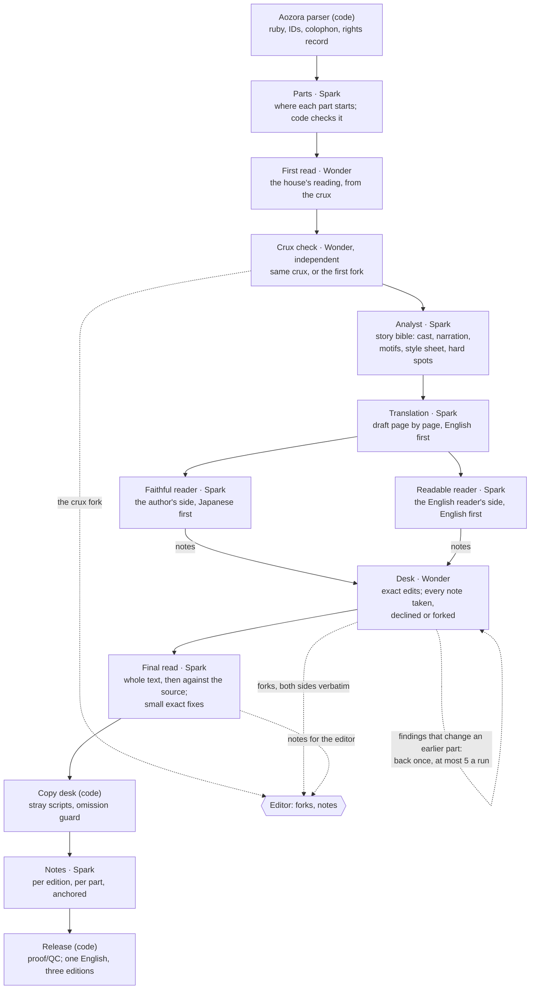

# keikaku — architecture

Written 27 Oct 2026, the second day of the hackathon; updated 2 Nov to match the code. §1, §3, §4, §6 and §10 describe the engine as built; the site, hosting and catalogue (§7–§8, and the tables in §2 marked for the site) are still the plan. See `CONCEPT.md` for what it's for and `BUILD-PLAN.md` for the order of work.

Design choices worth knowing first:
- **Built per source language, Japanese first.** `work.language` is a field; a text enters through a source adapter (Aozora is the first); the bible, departments and site are language-neutral; anything Japanese-specific (the Aozora adapter and parser, ruby, gaiji) sits in `house/lang/ja/`. Nothing else assumes Japanese.
- **Wonder where it earns its cost, Spark elsewhere.** Wonder writes the reading, checks the crux and runs the desk; Spark plans the parts, writes the bible, drafts, reads and does the final read. The model for drafting, reading, the desk and the final read is a run option; the defaults are what the experiments found best (`experiments/`).
- **Views share one base text**: one English per paragraph, not three separate translations; they differ only in their notes. (Work → edition → view: `CONCEPT.md`, "Words".)
- **The catalogue's reader's reports are generated on Meta models.**
- **Glimmer isn't used yet.** When it is, it works only on the English unless a spot check shows it reads Japanese well; its model card doesn't list Japanese.

## 1. Departments and flow

No manager agent. A deterministic orchestrator (plain code, the stages in order) moves the text between departments. Translation drafts the English; after the draft only the desk writes to it, plus the final read's small exact fixes. The two readers leave margin notes; the desk takes, declines or forks each one, with a reason. Heads select, never merge, and send forks up with each side's case word for word. The models in the chart are the defaults; the draft, the readers, the desk and the final read can each run on either.

**The exact order of stages, what each call takes and returns, and the limits code enforces are in `STAGES.md`; that list is what the orchestrator implements.** How a whole text moves through it, and the checkpoint, is in `RUNNING-A-TEXT.md`. Nothing loops: each part goes draft, two readers, desk, once. The one pass back is the emergency lever: at the end of the desk stage, each earlier part goes back to the desk once with what later parts taught it, at most five findings a run. At most five forks a run come from the desk, plus the crux fork; until the editor rules, the house's pick stands and is labelled as such. A reader may always answer "none", and a part with no notes never reaches the desk.

Planned and not built: Acquisitions and the editor's provenance check, the background brief, the checkpoint, the editor's letter, fact-check, Glimmer at the copy desk, interns, rule propagation, the reader desk. Sensitivity flags (dated or harmful content in the source) are planned as a query type routed to the editor, leading to context notes, never bowdlerising.

## 2. Data model (SQLite)

| Table | Holds |
|---|---|
| `work` | Aozora card, full colophon, rights record (death year, 初出, translation search + date), status |
| `bible` | The story bible and the house's reading per work, as versioned JSON (`STORY-STATE.md`); each version points at the event that changed it |
| `author_file` | Per author: what the house learned across their works, each entry with its provenance (`STORY-STATE.md` §1a). Nothing writes it yet |
| `segment` | Paragraphs `p12` from the source, Japanese with structured ruby, with sentence anchors `p12-s3` inside them for queries and notes. **The paragraph is the unit of English** (`STAGES.md`); which English renders which sentence is best-effort metadata the drafter returns, not a constraint on it |
| `revision` | Base English per paragraph or group, versioned, with the translator's notes and flags on the draft. Each revision points at the event that caused it (the draft, a desk edit with the notes it answers, a final-read fix) |
| `term` | Unused since 2 Nov, when the ledger was dropped (`STORY-STATE.md` §6). Kept only so `keikaku audit` can read runs made before then, whose English carries `{t:id}` placeholders |
| `note` | Anchor, editions it shows in, body, sources[], status `verified / unverified / killed`, author (department or person). Student hides anything unsourced |
| `query` | A reader's note or a code check's flag: from → owner, span, category, reason, evidence[], suggestion, how sure, status (*open*, *taken*, *declined*, *forked*, *unaddressed*), resolver |
| `fork` | Options (author + one-line trade-off), head's pick, the editor's decision, the rule it created |
| `rule` | Standing rule text, **explicit scope** (line / character / term / work / author / house), origin, lines it touched. The desk is told the active rules; nothing writes them yet |
| `lock` | Segment, who locked it. Code refuses any edit to a locked line; nothing writes locks yet |
| `status` | Per segment: draft / house-checked / editor-approved / human-reviewed, plus who. Nothing waits on the last two |
| `event` | Append-only log: run, seq, actor (department + role, or person), type, payload, cost. The single source for history, the House stream and replay |
| `call` | Model, effort, tokens (input / cached / output / reasoning), $, prompt hash, cache key |
| `intern` | Department, brief, logged reason, budget, spend, report. For interns, not built |
| `allowance` | Per editor: drops granted, reserved, spent; every grant with its reason (invite, funding target, house) |
| `reaction`, `proposal`, `person` | Two-axis reactions on a target (paragraph, note, or an alternative in a debate), with their counts never used to order or change anything; span proposals that become queries; trust level and how each person wants to be credited |
| `report` | Catalogue reader's report: reader-facing fields, internal scores, what it was based on, label, translation-status evidence and date |
| `edition` | One translation of a work: the editor (a person, or the house), its runs, current release. A house run releases to the house's edition |
| `release` | Edition version (v0.1, v0.2…), changelog, credits, and the released body (also written to `releases/` in the data folder) |
| `vote` | "I'd read this": work, voter token (cookie + IP hash), date. One per voter per work |
| `request` | An Aozora work ID or an outside reference (title, author, link), the requester's reason (screened), the Acquisitions verdict (*eligible / in copyright / can't tell*) with evidence, the editor's decision, status |

`allowance`, `reaction`, `proposal`, `person`, `report`, `vote` and `request` are for the site; they're in `db/schema.sql` and nothing writes them yet.

### The margin: how the debate reaches the page

Nothing is collected for the margin specially; it falls out of the record. Every note, decision, fork, ruling, footnote and revision is stored with an anchor: a paragraph ID, and a span inside it where there is one. The reader's margin for paragraph `p12` is simply everything anchored to `p12`, in time order, rendered by kind: the readers' notes with their evidence, what the desk did with each and why, a disagreement or fork with both cases, the editor's ruling, the translator's notes, the final read's fixes and notes, the footnotes with their sources, and the revision history. Each agent's one-sentence `say` is the plain-words line at the top of its entry. A paragraph nobody queried shows *drafted · checked · no queries* and nothing else. So the margin is a database read, the same read the House replay and the editor's desk use, and it is complete by construction: there is no way for a decision to happen that isn't anchored somewhere.

## 3. Agent runtime

- Plain Python, one call at a time, with the OpenAI SDK pointed at Meta's API on the **Responses API** (needed for caching hints and web_search). No agent framework.
- A stage is a module with `run(ctx)`; its prompt is a file in `prompts/` and its output schema is in `house/schemas/`. Every output schema has a `say` field, one plain sentence for the House log; an answer whose sentence is junk counts as a broken answer. Muse never exposes its reasoning, so the visible debate *is* what the agents write.
- **Prompts teach principles; code enforces limits.** A department prompt explains what the job is for and why (fidelity over fluency, keep deliberate ambiguity, raise a query only when it matters), so the agent can make a sensible call on a case nobody foresaw. Absolute "always / never" lines are kept for the few things that are crucial, because models follow them literally even where they stop making sense. Anything that must hold no matter what (the spend caps, the note caps, output schemas, locked lines) is enforced by code, not by the prompt. Prompts stay short as a result.
- The model client has a `FakeClient` that serves recorded responses from `fixtures/`, so the tests and a replay of a recorded run need no key. A paragraph's English changes at most at the draft, the desk (once more if the lever takes its part back) and the final read; nothing is argued over again.
- Everything runs in order: translation page by page, because each page sees the English before it; the later stages part by part. 429s and 5xx get retries with backoff (the SDK's, four tries). A schema failure is retried once; a Wonder call that fails twice is made again on Spark and logged.
- **A response cache** keyed on (model, effort, prompt, input, schema, tools, strict) makes reruns in development free and replays deterministic. A broken answer is never cached.
- **Standing-rule propagation** (planned, not built): a scoped search (regex, then a cheap Spark classifier on the candidates) finds the affected segments and sends them to the desk. The UI would show "R4 · 12 lines, 2 locked lines sent to the editor".

## 4. Which model does what

| Job | Model | Why |
|---|---|---|
| Parts, Analyst, translation, the readers, final read, notes | `muse-spark-1.3`, effort low for the parts and notes, medium elsewhere; reasoning can't be switched off. `prompt_cache_key` per work + bible version, `prompt_cache_retention: "24h"`. Non-strict schemas, validated by the client, except the readers and the final read (strict: once a part, it costs little) | Strong and cheap. The stable prefix caches at 88% off; strict mode gets no cache hits |
| First read, crux check and its comparison, the desk, the audits | `muse-wonder-1.0`, effort medium (low for the crux check and the comparison); always strict | A different and stronger checkpoint from the drafter, where the judgement is heaviest. The 1M context holds the whole source and translation in one call. Non-strict, Wonder left fields empty and wrote filler (2 Nov). A Wonder call that fails twice is made again on Spark |
| Copy desk (consistency, register) | Muse Glimmer 30B hosted on Modal, planned; not used yet, so the copy desk is code only | Open weights, near-free. Would propose replacements for flagged spans; never write the base text |
| Fact-check (planned) | Spark + `web_search` | Every note cites a source or dies |
| Catalogue (planned) | Spark low as the acquisitions editor; Glimmer as chunk reader if it passes a 10-report spot check, else Spark | Cheap at 200 reports |
| Requests from outside Aozora (planned) | Spark low + `web_search`: author dates, first publication, existing English translations; a short reader's report if a text is found | Capped per day; the editor confirms every verdict |
| Covers (planned) | `muse-image-1.0` | Decorative, $0.01 each. Cut first |

**About the shared lineage:** Glimmer is distilled from Spark, and Spark Open is Spark released as open weights. Wonder is a different, larger model but from the same family. So "a different model at the desk" here means a different checkpoint, not independence. **Every model this repo calls is a Meta model**, in the product and in the exhibit's audit alike: the hackathon's rule is strict (a participant's own tiny checker was ruled out), and the audit runs from this repo. So the auditor behind the experiments and the exhibit is Wonder (a cross-check by Spark Open, open weights on any host, is planned), and the page says so. What's independent of any model is the editor's read of the marked-up passages, the 1918 human translation in the exhibit, and the deterministic checks.

## 5. Interns

Not built yet; this is the design.

When a head meets something no department covers (an embedded poem, a dialect line, a classical quotation, a Buddhist term, a period object), it can ask for an intern: one research question with a reason. A real house would ring a specialist reader. Here the intern is a single Spark call at low effort with web search that returns a short report with sources; the head then continues with the report in hand. Interns never edit text and never hire.

**Mechanics, no tool calls.** The head's output schema has an optional `needs_intern: {question, reason}`. If it's set, the orchestrator checks the caps, runs the `intern` prompt, and re-runs the head with the report added to its input. Two plain calls instead of a tool call inside a structured-output call, which the API makes awkward (`tool_choice` is `auto` only). It replays from the cache like everything else.

**The runtime enforces:** one level only; at most 3 interns per run; $0.10 per department per run; a report, never edits; first thing given up when the pool runs low. The reason is logged and shown; in the House an intern is a dotted square attached to its department. Typical triggers are the Analyst's hard-spot flags. We make no quality claim for them; they're shown, not scored.

## 6. Long context

The full design is in `STORY-STATE.md`. In short:

- **Pages** of about 1K source tokens, never splitting a paragraph.
- **The whole source sits in the cached prefix** for any text up to 50,000 characters, which is every work in `fixtures/works.json` (the longest, 「思い出の記」, is about 31k). At $0.15 per million cached tokens, 24k tokens cost about $0.004 a call. So the model can look anywhere in the book, and the bible carries the decisions. Above 50,000 characters a per-page call gets its part in full and the other parts in a line each.
- **Look-ahead:** each call also sees the next paragraph of Japanese, read-only, because Japanese often resolves a subject or speaker after the fact.
- **Prompt order** (stable first, so it caches): house brief and department prompt; reading, voice and bible; the source; voice reference (the house's first page); the previous two paragraphs and the next one; the page.
- **A new bible version** bumps the cache key (`<work>:bible-v<N>`), so changes to it should be batched, not made mid-stage.
- **Continuity** is checked in the final read: one Spark call over the whole English and source up to 50,000 characters, part by part above that. The planted test (`BUILD-PLAN.md`, "The one test that's about the engine") would measure what it catches.
- Novels use the same pipeline (`STORY-STATE.md` §5); the bible's one-line part summaries aren't built, so the other parts show as their headings or first words.

## 7. Showing the house at work

Every event is written to `event`, and that record is what the House, the margin and the fixtures read. The full list of event types is `house/events.py`. A run writes `run.started`, `stage.started/done/failed`, `call.started/done`, `call.downgraded`, `agent.say`, `parts.planned`, `reading.written`, `crux.checked`, `bible.written`, `page.cut`, `draft.paragraph`, `chapter.read`, `query.raised/resolved`, `desk.done`, `disagreement.recorded`, `fork.opened`, `revision.created`, `check.flagged`, `final.read`, `note.written`, `release.made`, and `run.done`, `run.paused` or `run.stopped`.

**The House is a walkthrough of one finished run, not a live feed** (`SITE.md`, `/house`). It draws the text's route through the stages, shows a few picked moments at each stage, and opens any stage's full output. The engine flags candidates (queries, forks and rulings, large revisions, interns); the picks are a short list of event IDs, each with a one-line reason, and the page labels them as picked. Visitors can't start runs, so there's nothing to stream to them. Watching an editor's run live (Server-Sent Events read from the same log) is a later addition and the demo doesn't need it.

## 8. Stack, hosting, abuse

- **Stack:** Python 3.12 + FastAPI + SQLite (WAL) + Jinja templates. The front end is vanilla JS and CSS, with no build step. `uv` for packaging; pytest. One language serves the engine, the exhibit harness and the site. **No non-Meta ML model runs anywhere in the repo.**
- **Hosting:** one Railway service (Hobby plan, EU West region), deployed from the GitHub repo on push, with a volume for the data folder and secrets as Railway variables. Prompts and keys stay on the server; the browser only ever receives events, text and notes. What that means for the code:
  - Everything a run makes (the SQLite file, the response cache, audits, releases) lives in one data folder, `KEIKAKU_DATA_DIR`, set to the volume's mount path (`var/` when it's unset); the rest of the filesystem is wiped on every deploy, and the volume isn't mounted during the build.
  - One instance only: a service with a volume can't have replicas, and a redeploy stops the old instance before starting the new one, so each deploy means a few seconds of downtime. Don't deploy during anything live.
  - HTTP requests are cut off after 15 minutes (some users report 5). A run is started by a request that returns at once; the run itself works in the background in the same process.
- **Backup:**
  - The database on the volume is the record. Litestream (`litestream.yml`) streams it continuously to S3-compatible object storage; bucket, endpoint and keys are Railway variables (`.env.example`).
  - To restore, onto an empty volume with the service stopped: `litestream restore -config litestream.yml "$KEIKAKU_DATA_DIR/keikaku.db"`.
  - The response cache isn't backed up: it only saves money.
  - `keikaku download` (later a button) zips a run's full record and its editions as Markdown. That's the editor's own copy, not the backup.
- **Spend:**
  - Every call is priced from `usage` into a spend ledger.
  - The whole run is estimated before it starts and refused if it won't fit the run's cap or what's left of the daily or total cap. Before each live call, an estimate is checked against all three (defaults: $0.75 a run, $10 a day, $100 in total).
  - Meta's spend-limit notification is a backstop, not a stop.
  - A `HOUSE_OPEN=false` kill switch. A run stopped by a cap releases nothing and resumes later from the stage it stopped in (`EDITORS-DESK.md`); the site itself carries on.
- **Abuse:**
  - Visitors can't start runs. Only editors can, through invite links, on works from the eligible index, with the estimate reserved first. No free paste, so we're not a free translation proxy and there's no copyright risk.
  - Reactions are rate-limited by cookie and IP. Comments and proposals are screened by a model, published if they pass, removable by the editor, flat with no reply threads, capped per day, with a takedown contact.
  - Editor and reviewer powers come through signed, revocable invite links. No passwords.

## 9. What's in this repo

Everything the demo needs runs from this repo: the engine, orchestrator, schemas, the department prompts, the Aozora parser, the audit harness, the write-ups of what we tried (`experiments/`), and replay fixtures. The UI and the exhibit renderer will live here too. An optional private overlay (`KEIKAKU_PRIVATE_DIR`) can add voice profiles for other authors and longer word lists; the demo never depends on it. Copyrighted human translations used in evals are quoted in short excerpts only and never committed whole.

## 10. Cost model

**Assumptions:**
- Japanese source: 1.5 tokens per character.
- English: 0.6 tokens per source character.
- Stable prefix ~5k tokens, 80% of it cached.
- **Reasoning is billed as output.** Base case: medium effort ≈ 2× visible output, low ≈ 1k tokens per call (Wonder 1.5k). **Pessimistic: double the reasoning.** The first calls (M0) measure the real ratio, and this table gets updated.

**Measured at M0, 1 Nov** (a calibration script, since removed: 「晩餐」, the whole text in the input, drafting p1–p8, 1,055 characters, with no reading or bible yet):

| Call | Input | Cached | Output | of which reasoning | Reasoning ÷ visible | $ |
|---|---|---|---|---|---|---|
| Spark draft, low | 6,046 | 0 | 3,793 | 621 | 0.20 | 0.024 |
| Spark draft, medium | 6,046 | 0 | 6,925 | 2,533 | 0.58 | 0.037 |
| Spark + web search (8 searches), low | 56,278 | 44,853 | 2,798 | 512 | 0.22 | 0.053 |
| Wonder crux check, whole text, low | 4,070 | 0 | 1,335 | 557 | 0.72 | 0.043 |

What it changes: reasoning is far cheaper than assumed (medium ≈ 0.6× visible, not 2×; Wonder low ≈ 550 tokens, not 1.5k). Visible output is far larger: the draft returned ~3–4k visible tokens for 1,055 characters, against the 630 assumed, because sentence spans repeated the English and every paragraph carried notes. Sentence spans have since been dropped. Drafting at medium is ≈ $0.035 per 1,000 characters, about 1.6× the plan's base rate; Wonder is ≈ $0.013 per 1,000 characters of a whole-text read at low effort, about a third of the assumption. Web search is dominated by the search results fed back as input (56k tokens), not by the $2.50 per 1,000 searches. **Strict JSON schemas switch prompt caching off**: with `strict: true` two calls sharing a 3.7k-token prefix got no cache hit; with `strict: false` the second got 3,697 cached. So Spark's calls go non-strict (the output still follows the schema) and the client validates every response itself, with the one retry. Wonder's go strict: non-strict, it left required fields empty and wrote filler on long outputs (2 Nov), and its calls are few.

Prices per million tokens (in / cached / out): Spark $1.25 / $0.15 / $4.25; Wonder $4 / $0.20 / $20; Glimmer hosted ≈ $0.30 / $0.04 / $1.20; web_search $2.50 per 1k searches.

**Measured on 「晩餐」, 2 Nov**, in dollars per 1,000 source characters, with the default set-up (`house/budget.py`, `STAGE_RATES`; the parts call is too small to count):

| Stage | Default model | $ per 1,000 chars | On the other model |
|---|---|---|---|
| First read | Wonder | 0.025 | |
| Crux check | Wonder | 0.025 | |
| Bible | Spark | 0.015 | |
| Draft | Spark | 0.036 | Wonder 0.075 |
| Both readers | Spark | 0.033 | Wonder 0.065 |
| Desk | Wonder | 0.047 | Spark 0.019 |
| Final read | Spark | 0.015 (a first guess) | Wonder 0.04 |
| Notes | Spark | 0.0075 | |
| **Total** | | **≈ $0.20** | |

The plan said $0.16 base and $0.27 pessimistic; the measured total sits between them. The estimate a run is checked against before it starts takes these rates, adds the lever's pass back for a text of more than one part, and multiplies by 1.5, so a run that starts shouldn't run out.

The per-text figures below were planned on 30 Oct at the planned rates; at the measured rate a full run of 「晩餐」 costs about $0.70, and 8,000 characters about $1.60.

| Text | Chars | One full run (base / pessimistic) | Planned spend |
|---|---|---|---|
| Shiraki Shizu 「晩餐」 (development text) | 3,400 | $0.54 / $0.92 | 5 tuning runs, inside "dev" below |
| Kitamura Tōkoku 「我牢獄」 (the hard text) | 4,500 | $0.72 / $1.22 | 3 runs: $2.2 / $3.6 |
| Kasai Zenzō 「雪をんな」 (plain control) | 3,200 | $0.51 / $0.86 | 3 runs: $1.5 / $2.6 |
| Koizumi Setsu 「思い出の記」 (vs its 1918 translation) | 30,700 whole; the brief always runs on the whole text | $4.9 / $8.3 whole; ~$0.9 / $1.5 for three windows after the brief | 1 whole run if the budget holds, else windows |
| **Showcase (provisional, 1 Nov): Nagatsuka Takashi 「炭燒のむすめ」** | 8,000 | **$1.28 / $2.16**; ~$3.1 at the rate the first real run on 「晩餐」 measured | 2 runs + rule reruns: $3.8 / $6.5 |
| Stretch: Natsume Sōseki 「幻影の盾」 | 22,100 | $3.54 / $5.97 | 1 run |

| Budget line, inside the $150 credits | Base | Pessimistic |
|---|---|---|
| Dev: smoke tests, prompt tuning, failed runs, 晩餐 ×5 | $25 | $40 |
| The other texts (Tōkoku, Kasai, Setsu whole) | $8.6 | $14.5 |
| Showcase | $3.8 | $6.5 |
| The exhibit (audit on all versions, both auditors) and the planted test | $8 | $14 |
| Catalogue, 200 reports | $4 | $7 |
| Rehearsals and video takes; covers | $6 | $11 |
| Stretch, one run | $3.5 | $6 |
| **Total** | **≈ $58** | **≈ $99** |

**Headline:** everything, the stretch included, fits in the $150 credits even in the pessimistic case. The live site after submission runs on separate billing, capped at $10 a day.

If reasoning turns out worse than pessimistic, there are three levers, in this order:
1. Run the desk on Spark (`--desk-model spark`): less than half the desk's cost, and experiment 2 found no clear difference in quality.
2. Use Meta's cheaper Contributor tier for the shelf and the other texts.
3. Drop the stretch.
